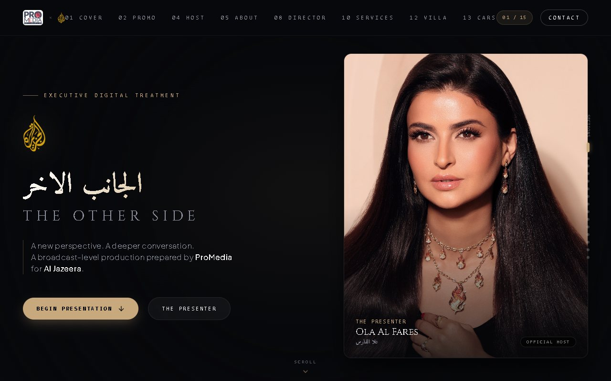

# SHARP PRO MEDIA - Premium Interactive Microsite



🌐 **Live Production Deployment:** [pro-media-microsite.vercel.app](https://pro-media-microsite.vercel.app)  
👨‍💻 **Engineering & Execution:** [Mostafa Mohamed Farhat (Elshorbagy)](https://mostafa-portfolio-iota.vercel.app/) — *Interactive 3D Agency Microsite Engineering (ProMedia)*

---

A state-of-the-art, high-performance interactive digital business card and microsite built for **Pro Media**. It behaves like an Awwwards-winning luxury creative agency landing page rather than a basic links page, designed with cinematic aesthetics, realistic 3D orbits, custom micro-interactions, and a responsive dark theme.

---

## 🚀 Features & Interactions

1. **Animated Cinematic Background**
   - Integrates **React Three Fiber (R3F)** and **Three.js** to render a 3D canvas of floating ambient dust particles.
   - Parallax effects responding to mouse movement.
   - Dynamic camera lens flare overlay mapping opposite to cursor direction.
   - SVG viewfinders, camera grid overlays, and moving film strips to simulate high-end cinematography gear.

2. **Advanced Orbit Link System**
   - 9 social links distributed across 3 concentric rings (Website, WhatsApp, Email, Instagram, Facebook, LinkedIn, YouTube, TikTok, Location).
   - Trigonometric orbital positions moving in continuous, organic cycles.
   - Orbit paths and phases shift naturally every 6 seconds to prevent static layouts.
   - Hover magnification: Hovering over an item pauses its rotation, moves it closer to the screen (3D depth offset), activates a glow and glass reflection sweep, while other orbits damp to 15% speed.
   - Unique animations for each platform click (e.g., Instagram spin, Facebook bounce, LinkedIn flip, WhatsApp bubble expansion, etc.).

3. **Center Profile & Cinematic Rings**
   - Creative Director portrait framed inside a premium glass lens ring.
   - Slowly rotating concentric dashed rings and pulsing radial glows.
   - Double-layered custom drop shadows.

4. **Magnetic Custom Cursor**
   - Smooth lag-following outer ring cursor using Framer Motion springs.
   - Attracts and expands on interactive elements.
   - Desktop and tablet optimized, fallback cursor handling on touch-only mobile devices.

5. **Production Ready & SEO Optimized**
   - Built with Next.js 15, React 19, TypeScript, and TailwindCSS.
   - Configured with sitemap generator, robots guidelines, web app manifest, and meta descriptions.
   - Achieves a fast load time and complies with modern web guidelines.

---

## 🛠️ Project Structure

```text
pro-media-microsite/
├── app/
│   ├── layout.tsx         # Page layouts, Google Fonts (Outfit & Inter), metadata configs
│   ├── page.tsx           # Home view & synchronized entrance animations
│   ├── robots.txt         # Crawler settings
│   ├── sitemap.ts         # Sitemap indexing generator
│   └── globals.css        # Tailwind V4 import and custom utility classes
├── components/
│   ├── AnimatedBackground.tsx  # Three.js star dust and parallax overlays
│   ├── CenterProfile.tsx       # Glowing rings and profile image container
│   ├── CustomCursor.tsx        # Magnetic spring cursor mechanics
│   ├── LogoHeader.tsx          # Large titles and aperture logo
│   ├── OrbitSystem.tsx         # Orbit calculations and animation loops
│   └── SocialObject.tsx        # Styled 3D cards/cubes for each link
├── config/
│   └── links.ts           # Central config file for social media URLs
├── public/
│   ├── profile.png        # Profile picture
│   └── manifest.json      # PWA App manifest
├── types/
│   └── index.ts           # Shared TypeScript interfaces
├── package.json           # Build dependencies
├── tsconfig.json          # TS setup compiler settings
└── README.md              # Documentation
```

---

## ⚙️ Setup & Execution

Follow these steps to run the project locally on your machine:

### 1. Install Dependencies
Navigate to the project root directory and install npm packages:
```bash
npm install --legacy-peer-deps
```
*Note: The `--legacy-peer-deps` flag is recommended because React 19 is newly released and peer warnings are expected for React Three Fiber sub-libraries. R3F works smoothly on React 19.*

### 2. Run the Development Server
Start the development dev server locally:
```bash
npm run dev
```
Open [http://localhost:3000](http://localhost:3000) in your browser.

### 3. Build for Production
To compile and test the optimized production build:
```bash
npm run build
```
To run the production build locally:
```bash
npm run start
```

---

## 🔗 Customization

To update the social URLs, simply edit [links.ts](file:///C:/Users/0000/.gemini/antigravity/scratch/pro-media-microsite/config/links.ts):

```typescript
export const socialLinks = {
  instagram: "https://instagram.com/pro.media.creative",
  facebook: "https://facebook.com/promedia.creative",
  linkedin: "https://linkedin.com/company/promedia-creative",
  youtube: "https://youtube.com/c/promediacreative",
  tiktok: "https://tiktok.com/@promedia.creative",
  whatsapp: "https://wa.me/1234567890",
  website: "https://pro-media.com",
  email: "mailto:info@pro-media.com",
  location: "https://maps.google.com/?q=New+York+City",
};
```
Modifying this object will automatically update all the links and logos across the entire orbital microsite!
